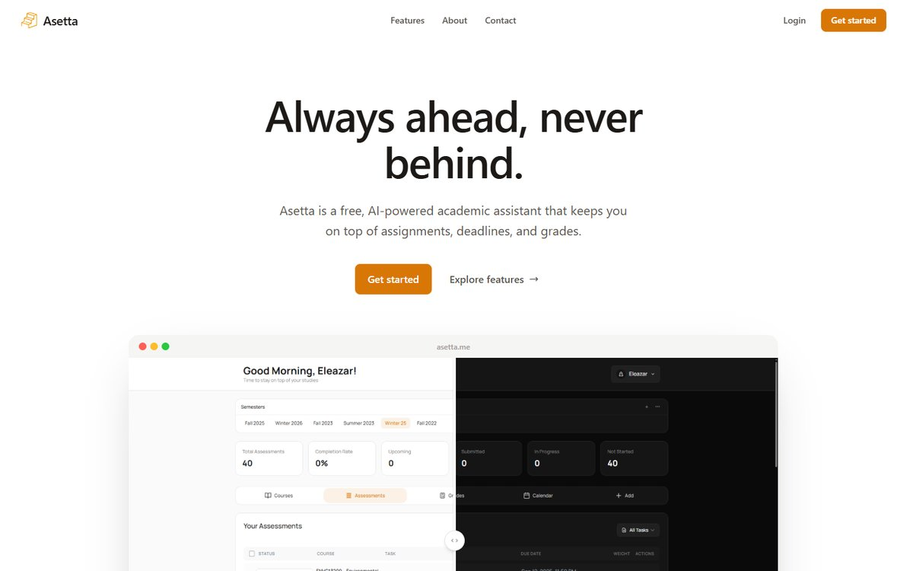
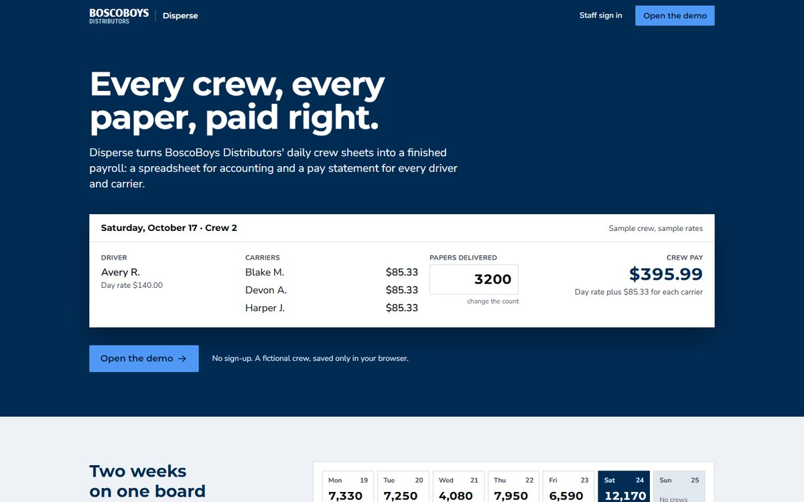
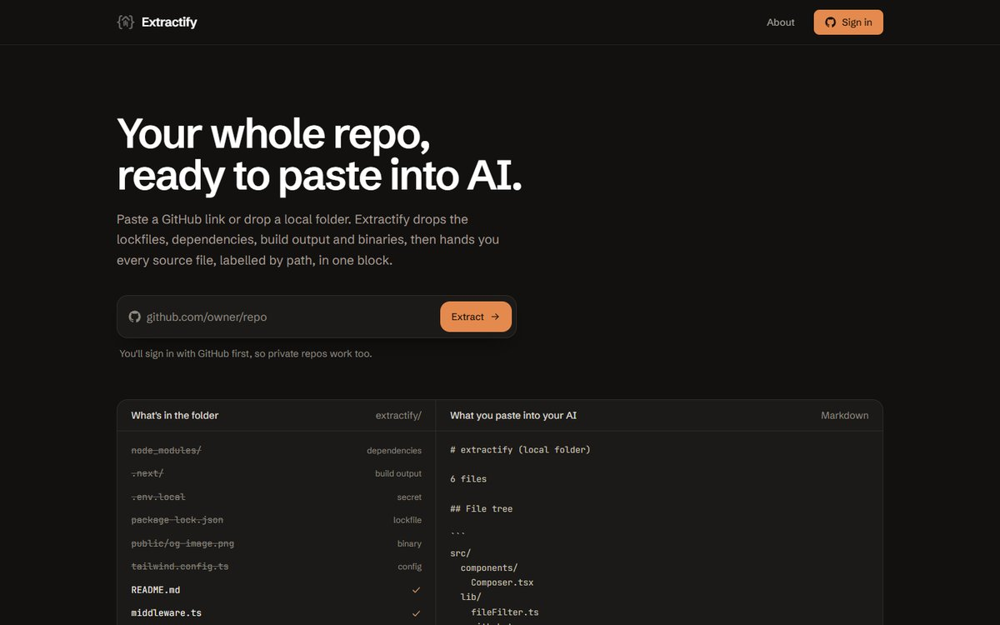
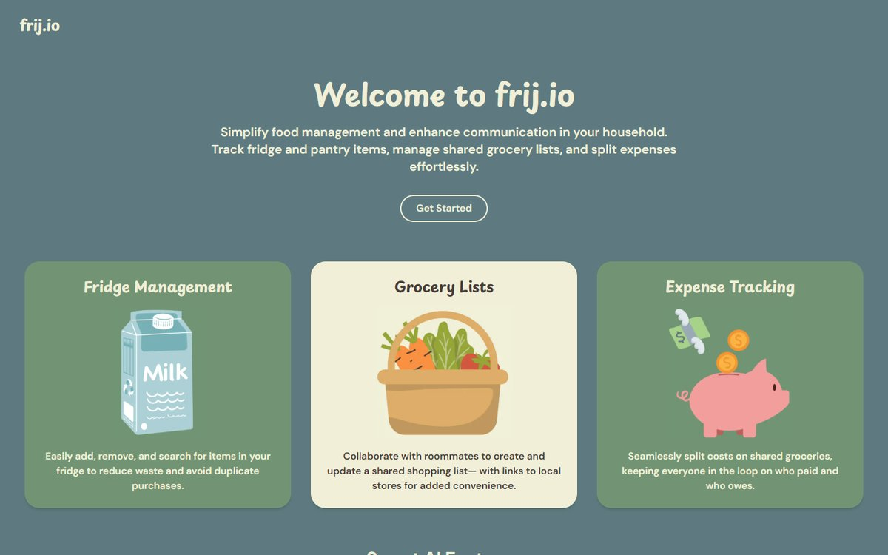
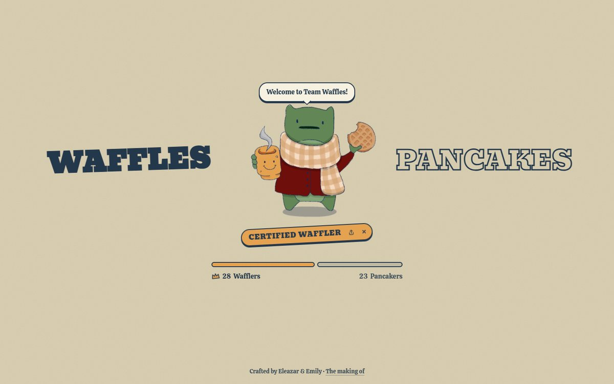
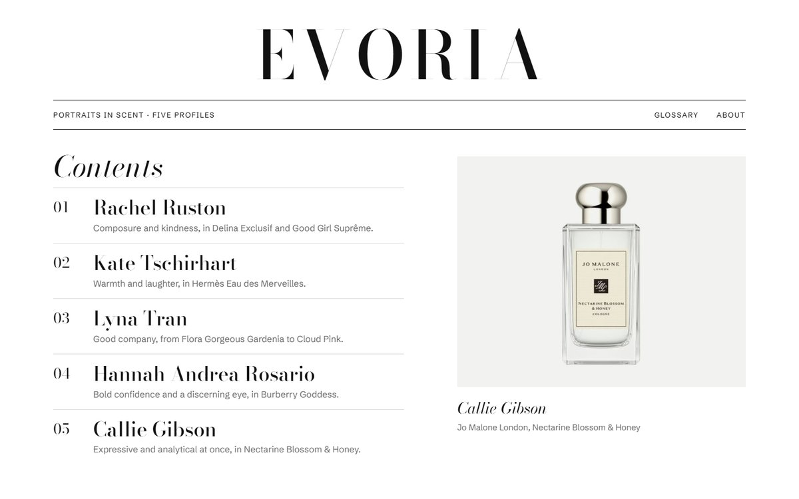
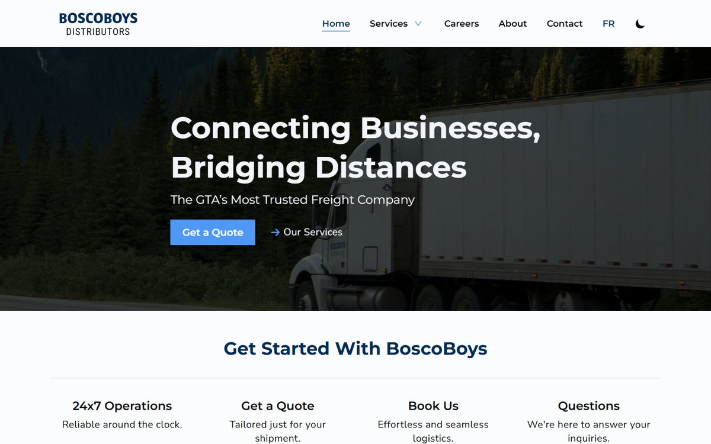
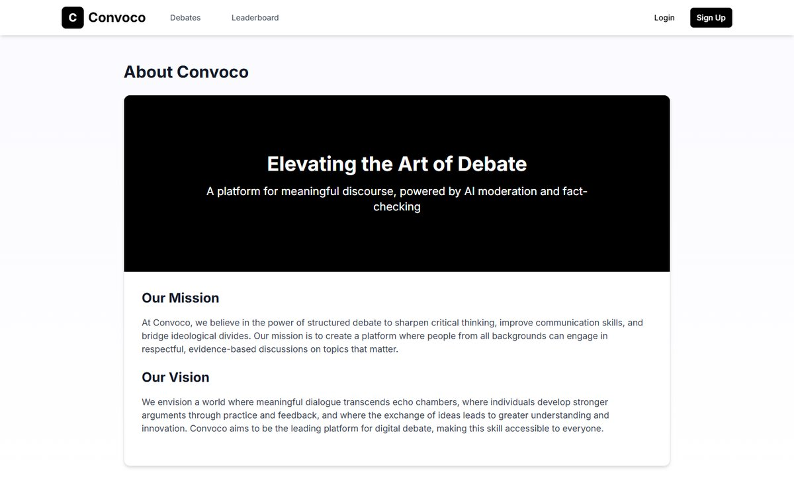

# Hey, I'm Eleazar
[Portfolio](https://psalm-eleazar.vercel.app/) • [LinkedIn](https://www.linkedin.com/in/pevidena/) • [Email](mailto:videna.psalmeleazar@gmail.com) • [X](https://twitter.com/psalmeleazar)

I'm a software engineering student at the University of Guelph, based in Toronto. My co-op terms have taken me from the factory floor to the bank, building software for manufacturing at ATS Corporation and working on technology research at BMO. As I finish my degree, I'm looking for where I can keep building real solutions for the people who use them.

## Spotlight

<table>
  <tr>
    <td width="50%" valign="top">
      
      <h3>Asetta</h3>
      
<em>2025 to now</em>

      

        An academic planner for students. Upload a course outline and
        it pulls out every assessment, due date and weight, then keeps
        your grades, calendar and deadline reminders in one place.
      

      

        <code>Next.js</code> <code>TypeScript</code> <code>Firebase</code> <code>Gemini</code> <code>Tailwind CSS</code>
      

      

        <a href="https://www.asetta.me">asetta.me ↗</a> &nbsp;·&nbsp;
        <a href="https://github.com/P541M/asetta">Source ↗</a>
      

    </td>
    <td width="50%" valign="top">
      
      <h3>Disperse</h3>
      
<em>Internship at BoscoBoys Distributors · 2024, refreshed in 2026</em>

      

        Payroll for newspaper delivery crews. Two weeks of daily crew
        sheets become an Excel sheet for accounting and a PDF pay
        statement for every driver and carrier, with CPP, EI and tax
        estimates for employees.
      

      

        <code>React</code> <code>Express</code> <code>MongoDB</code> <code>Tailwind CSS</code> <code>Vitest</code>
      

      

        <a href="https://bbd-disperse.vercel.app/demo">Try the demo ↗</a>
      

    </td>
  </tr>
  <tr>
    <td width="50%" valign="top">
      
      <h3>Extractify</h3>
      
<em>2025, refreshed in 2026</em>

      

        I built this in early 2025, before coding agents could explore
        a codebase on their own and sharing a project with an AI meant
        copying files in one by one. Extractify turns a GitHub repo or
        local folder into one block of code you can paste into any chat,
        skipping lockfiles, build output and secrets, with a token count
        before you copy.
      

      

        <code>Next.js</code> <code>TypeScript</code> <code>NextAuth</code> <code>Firestore</code> <code>Tailwind CSS</code>
      

      

        <a href="https://extractifycode.vercel.app">extractifycode.vercel.app ↗</a>
      

    </td>
    <td width="50%" valign="top">
      
      <h3>frij.io</h3>
      
<em>Hack Canada 2025 · Best AI award · team of four</em>

      

        A shared fridge for housemates. Track what's inside, build one
        grocery list together and split the bill. Scan a receipt to log
        groceries, and get recipe ideas from what you already have.
      

      

        <code>Next.js</code> <code>TypeScript</code> <code>Firebase</code> <code>Google Vision</code> <code>Perplexity</code>
      

      

        <a href="https://frijio.vercel.app">frijio.vercel.app ↗</a> &nbsp;·&nbsp;
        <a href="https://github.com/megdcosta/frijio">Source ↗</a>
      

    </td>
  </tr>
</table>

## Also made

<table>
  <tr>
    <td width="25%" valign="top">
      
      
<strong><a href="https://waffles-or-pancakes.vercel.app">Waffles or Pancakes?!</a></strong> 
      A one-question breakfast poll, starring a frog drawn by Emily Chang.

    </td>
    <td width="25%" valign="top">
      
      
<strong><a href="https://evoria-ochre.vercel.app">Evoria</a></strong> 
      Portraits in scent: people close to me, each paired with a fragrance I chose for them.

    </td>
    <td width="25%" valign="top">
      
      
<strong><a href="https://boscoboys-distributors.vercel.app">BoscoBoys Distributors</a></strong> 
      A revamped website for the company, built during my 2024 internship.

    </td>
    <td width="25%" valign="top">
      
      
<strong><a href="https://convoco.vercel.app">Convoco</a></strong> 
      Debate practice with AI moderation and fact-checking, built at GenAI Genesis 2025.

    </td>
  </tr>
</table>

Explore these projects in more depth on my <a href="https://psalm-eleazar.vercel.app/">portfolio</a>. If something here sparks an idea, <a href="mailto:videna.psalmeleazar@gmail.com">say hi</a>.
